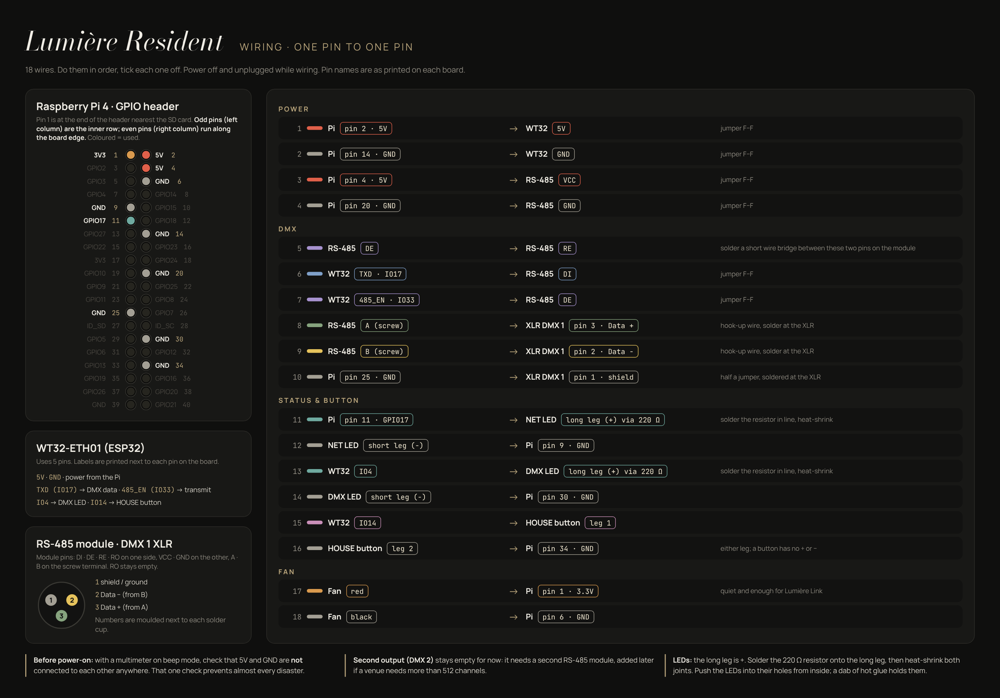

# Lumière Resident: wiring

18 wires, each from one pin to one pin. Work with the power **off and unplugged**,
in this order, ticking each one off. Pin names are as printed on each board.

The Raspberry Pi powers everything through its GPIO header: the WT32-ETH01 and
the RS-485 module need no power supply of their own.

## Raspberry Pi 4 header

Pin 1 is at the end of the 40-pin header nearest the SD card. Odd pins are the
inner row; even pins run along the board edge.

## Wires

| # | From | To | How |
|---|---|---|---|
| **Power** | | | |
| 1 | Pi pin 2 (5V) | WT32 **5V** | jumper F–F |
| 2 | Pi pin 14 (GND) | WT32 **GND** | jumper F–F |
| 3 | Pi pin 4 (5V) | RS-485 **VCC** | jumper F–F |
| 4 | Pi pin 20 (GND) | RS-485 **GND** | jumper F–F |
| **DMX** | | | |
| 5 | RS-485 **DE** | RS-485 **RE** | solder a short bridge between the two pins |
| 6 | WT32 **TXD (IO17)** | RS-485 **DI** | jumper F–F |
| 7 | WT32 **485_EN (IO33)** | RS-485 **DE** | jumper F–F |
| 8 | RS-485 **A** (screw) | XLR DMX 1 **pin 3** (Data +) | hook-up wire, soldered at the XLR |
| 9 | RS-485 **B** (screw) | XLR DMX 1 **pin 2** (Data −) | hook-up wire, soldered at the XLR |
| 10 | Pi pin 25 (GND) | XLR DMX 1 **pin 1** (shield) | half a jumper, soldered at the XLR |
| **Status & button** | | | |
| 11 | Pi pin 11 (GPIO17) | NET LED long leg (+), through 220 Ω | resistor soldered in line, heat-shrink |
| 12 | NET LED short leg (−) | Pi pin 9 (GND) | |
| 13 | WT32 **IO4** | DMX LED long leg (+), through 220 Ω | resistor soldered in line, heat-shrink |
| 14 | DMX LED short leg (−) | Pi pin 30 (GND) | |
| 15 | WT32 **IO14** | HOUSE button, leg 1 | |
| 16 | HOUSE button, leg 2 | Pi pin 34 (GND) | either leg: a button has no + or − |
| **Fan** | | | |
| 17 | Fan red | Pi pin 1 (3.3V) | quiet, and enough for Lumière Link |
| 18 | Fan black | Pi pin 6 (GND) | |

The XLR's pin numbers are moulded next to each solder cup. **DMX 2** stays empty
for now: it needs a second RS-485 module, added if a venue needs more than 512
channels.

## Before the first power-on

With a multimeter on beep (continuity) mode, check that **5V and GND are not
connected anywhere**: touch Pi pin 2 and pin 6. No beep = good. This one check
prevents almost every disaster.

## Pins the software uses

The ESP32 program and the Pi setup rely on these; change them together.

| Board | Pin | Job |
|---|---|---|
| WT32-ETH01 | IO17 (TXD) | DMX data out |
| WT32-ETH01 | IO33 (485_EN) | RS-485 transmit enable (held high) |
| WT32-ETH01 | IO4 | DMX LED |
| WT32-ETH01 | IO14 | HOUSE button (internal pull-up, pressed = low) |
| Raspberry Pi | GPIO17 (pin 11) | NET LED |
