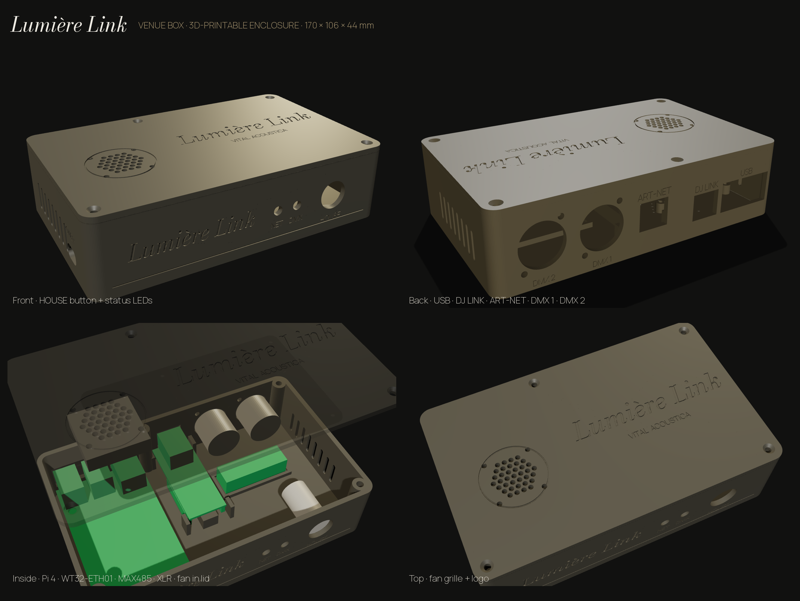

# Lumière Link venue box: 3D-printed enclosure

One box, 170 × 106 × 44 mm, holds the whole venue setup: a Raspberry Pi 4 (with
its fan), the ESP32 DMX board (WT32-ETH01), the RS-485 module, two DMX outputs,
a **HOUSE** button and two status LEDs.



## Files to print

| File | Print orientation |
|---|---|
| `out/lumiere-venue-box-base.stl` | As it comes: open side up |
| `out/lumiere-venue-box-lid.stl` | As it comes: already upside down, top face on the bed |

## Print settings

- **Material:** PETG (best for a hot club: it won't soften near lights or in a
  hot rack). PLA is fine for trying the fit. Matte black or dark grey looks classy.
- **Layer height:** 0.2 mm (0.16 mm for crisper lettering).
- **Walls:** 4 perimeters; infill 20–25 % gyroid.
- **Supports:** none needed for the base. The openings are small enough to bridge.
  Enable "supports on build plate only" if your printer struggles with the XLR holes.
- **Brim:** helps PETG stay flat on large parts.
- Print a **test piece first**: slice only the bottom 15 mm of the back wall to check
  the XLR and Ethernet openings against your real parts before the full print.

A nice touch: after printing, rub a little brass- or gold-coloured paint (or a
wax "rub 'n buff") into the engraved lettering and wipe off the surface.

## Hardware to buy

| Part | Qty |
|---|---|
| M3 heat-set inserts (4.2 mm hole, 5–6 mm long) | 4 |
| M3 × 8 mm countersunk screws (lid) | 4 |
| M2.5 × 6 mm screws (Raspberry Pi, self-tapping into the standoffs) | 4 |
| 16 mm momentary push button (panel mount) | 1 |
| 5 mm LEDs + 220 Ω resistors (status: NET, DMX) | 2 |
| Neutrik-style D-size female XLR sockets (24 mm hole) | 1–2 |
| M3 × 10 screws + nuts for the XLR sockets | 4 |
| 10 mm round rubber feet (stick-on) | 4 |
| Double-sided foam tape (for the WT32-ETH01 and the RS-485 module) | a strip |

The Pi's case fan (30 mm) screws to the underside of the lid, under the grille.

## Assembly order

1. Press the 4 heat-set inserts into the corner posts with a soldering iron
   (or skip them and use M3 self-tapping screws straight into the plastic).
2. Screw the Raspberry Pi to its 4 standoffs: USB-C power faces the left wall,
   network and USB face the back.
3. Fit the XLR sockets from the outside and bolt them on.
4. Stick the WT32-ETH01 onto its centre rib (Ethernet jack into the ART-NET
   opening) and the RS-485 module into its tray, with foam tape.
5. Fit the HOUSE button and the LEDs from the front.
6. Wire it up (the build guide covers this), screw the fan under the lid,
   close the lid with the 4 countersunk screws, and stick on the feet.

## Changing the design

Everything is generated by `enclosure.py`. The sizes are numbers at the top
(board sizes, socket holes, clearances). Edit them, then run:

```bash
pip install manifold3d trimesh matplotlib numpy
python3 enclosure.py
```

It rebuilds both STL files and checks that none of the parts collide.

**Measure before printing:** the WT32-ETH01's size differs between sellers
(55–63 × 25 mm), so its holder is deliberately roomy. If your XLR sockets aren't
Neutrik D-size, measure the hole and the screw spacing and change
`XLR_HOLE` / `XLR_SCREW_OFF`.
